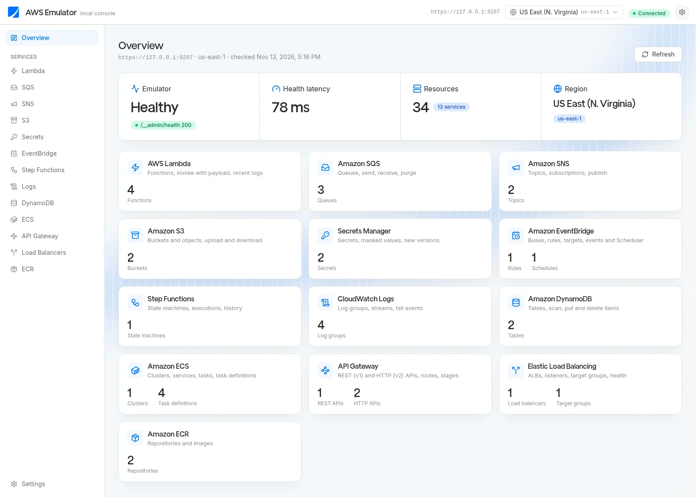
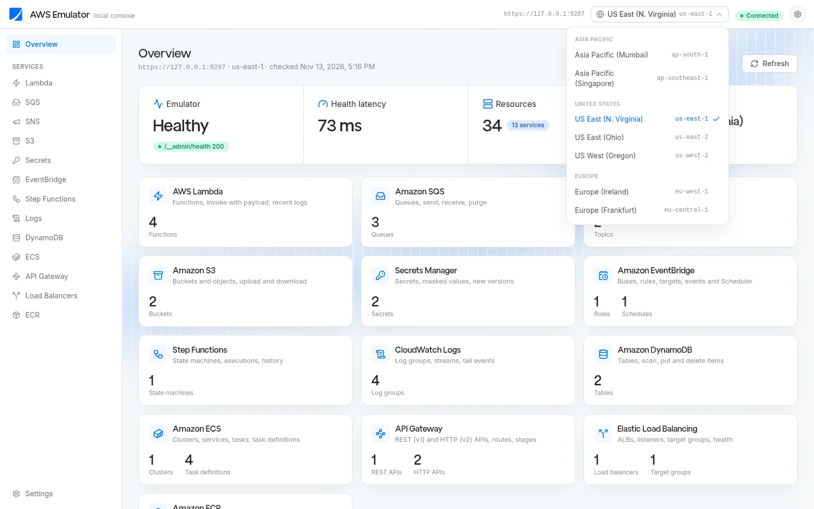
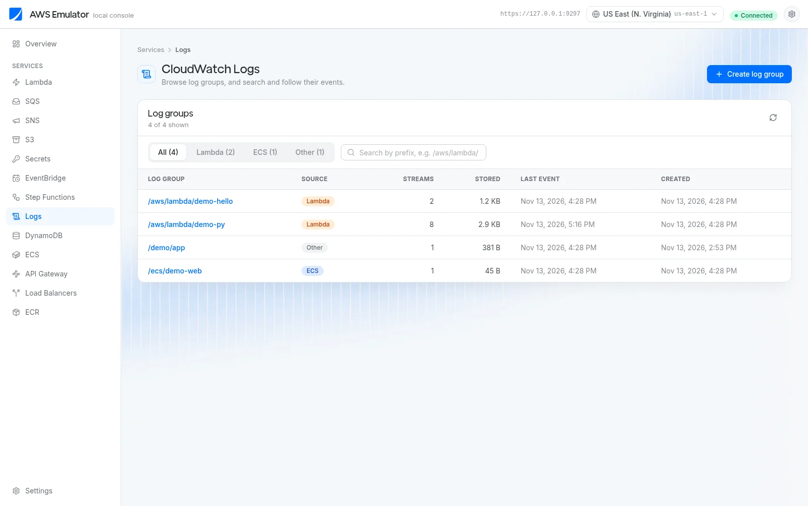
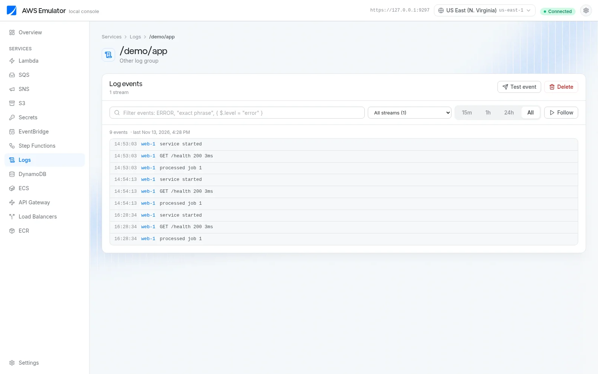
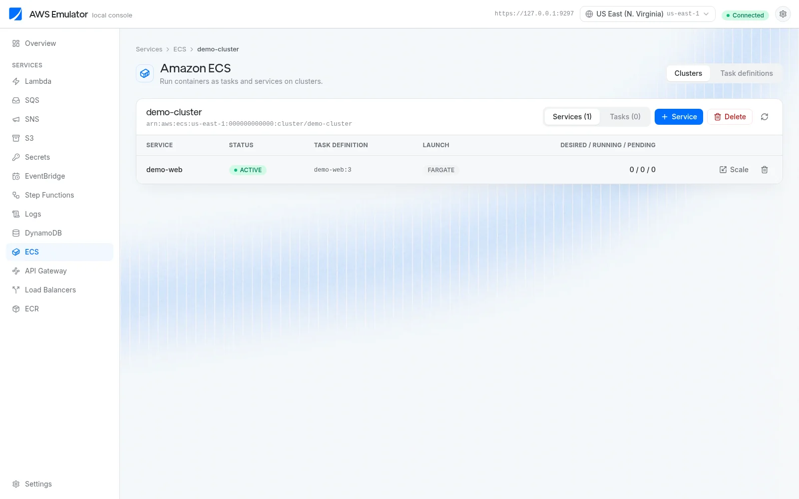
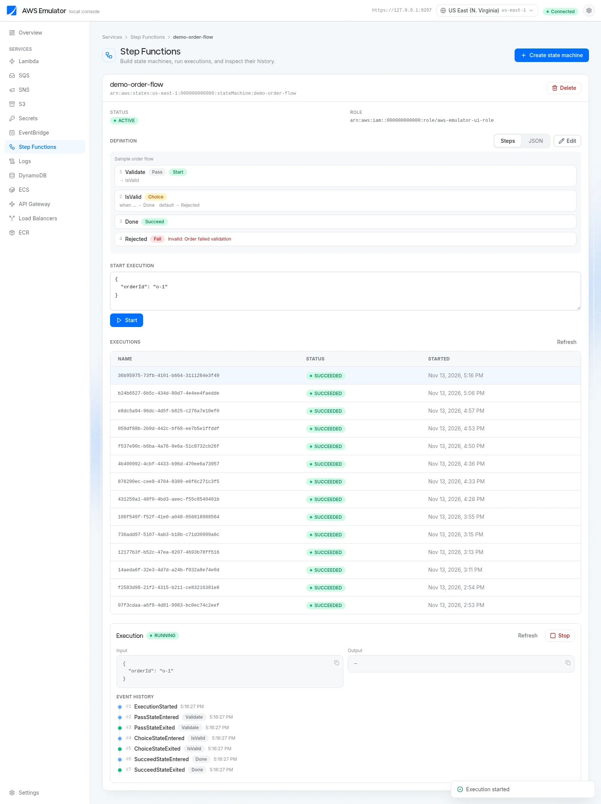

# AWS Emulator

A local web console for [Floci](https://github.com/floci-io/floci), styled with the
Gushwork UI design system (Tailwind v4 tokens, Inter + VertGrotesk, `#0070FF` accent, light mode).

It covers **13 services**: Lambda, SQS, SNS, S3, Secrets Manager, EventBridge (+ Scheduler), Step Functions,
CloudWatch Logs, DynamoDB, ECS, API Gateway (REST v1 + HTTP v2), Elastic Load Balancing v2 and ECR.
Each service page lists resources, shows details and supports basic create / delete (with confirm dialogs)
plus the everyday actions (invoke, send/receive, publish, upload/download, put events, start execution,
tail logs, DynamoDB scan, run task, scale, export, register target, …).

There is also a **Deployments** page and a CLI (`aws-emulator deploy`) that turn a `serverless.yml` or
`trinity.yml` into resources on Floci.

If Floci answers `NotImplemented` for something, the UI shows an orange
**"Not supported by Floci yet"** state. It never fakes data.

## Screenshots

**Overview:** backend health, resource counts per service, and the current region.



**Region menu:** pick the region in the top bar, as in the AWS console. Every page follows it.



**CloudWatch Logs:** all log groups, filtered by source (Lambda, ECS, Other) or by prefix.



**Log group:** one page to filter, pick a stream and time range, and follow new events live.



**ECS cluster:** services and tasks of a cluster, with launch, scale and delete.



**Step Functions:** the state machine's steps, its executions, and the event history of a run.



## Startup guide (macOS)

### 1. Prerequisites

| Tool | Version | Check |
|---|---|---|
| Node.js | 20+ | `node -v` |
| Docker Desktop | current | `docker info` (must be running) |
| AWS CLI v2 (optional, to poke Floci from a terminal) | 2.x | `aws --version` |

### 2. Clone and start

```bash
git clone git@github.com:shubhamjha-gushwork/aws-emulator-ui.git
cd aws-emulator-ui
scripts/start-local.sh --seed
```

`scripts/start-local.sh` does this:

1. Creates the Docker network `floci-net` if needed, and starts the `floci` container (`floci/floci:latest`) on **http://127.0.0.1:4566**. The container is localhost-only, capped at 2 GB, and is given the Docker socket plus `FLOCI_SERVICES_*` so Lambda, ECS and ECR can run real containers and `docker push` works.
2. Builds the UI if needed and starts it on **http://127.0.0.1:3297**.
3. `--seed` creates `demo-*` resources in all 13 services.

A running `aws-emulator` container, if you still have one, is left alone. This project no longer starts or stops it.

### 3. Stop

```bash
scripts/stop-local.sh            # stop the UI and Floci
scripts/stop-local.sh --ui-only  # stop only the UI
```

> **Data is in memory only.** Stopping Floci, quitting Docker Desktop or rebooting wipes its resources. Run `npm run seed` again after a restart if you want the demo data back.

### 4. Point the AWS CLI / SDKs at Floci

Floci is plain HTTP and accepts any non-empty keys (commonly `test` / `test`):

```bash
export AWS_ACCESS_KEY_ID=test
export AWS_SECRET_ACCESS_KEY=test
export AWS_DEFAULT_REGION=us-east-1
export AWS_ENDPOINT_URL=http://127.0.0.1:4566
# optional, so a real profile cannot leak in:
# unset AWS_PROFILE
# export AWS_CONFIG_FILE=/dev/null AWS_SHARED_CREDENTIALS_FILE=/dev/null

aws sts get-caller-identity
```

The account id is `000000000000`. `unset AWS_ENDPOINT_URL AWS_ACCESS_KEY_ID AWS_SECRET_ACCESS_KEY` to go back to real AWS.

### 5. Troubleshooting

- **UI says Floci isn't answering:** `docker ps` should show `floci` healthy, and `curl http://127.0.0.1:4566/_floci/health` should return 200. Start Docker Desktop, then `scripts/start-local.sh`.
- **ECR `docker push` / ECS can't pull:** Floci and its registry sidecar must be on the user-defined network `floci-net`. The start script does this; don't run Floci on the default `bridge` network.
- **First Lambda or ECS call is slow:** Floci is pulling a real image. Later calls are faster.

## Deploy serverless.yml and trinity.yml

The CLI creates (or updates) the resources described by a Serverless Framework or Trinity file on Floci. It does **not** call real AWS, and it never reads SSM or Secrets Manager in a real account.

```bash
# from this repo
npx aws-emulator deploy /path/to/service --stage local --region us-east-1
npm run deploy:local -- /path/to/service --stage local

# plan only
npx aws-emulator deploy /path/to/service --dry-run
# or
npx aws-emulator plan /path/to/service

npx aws-emulator list
npx aws-emulator destroy /path/to/service          # or a deployment id from `list`
```

Options: `--stage` (default `local`), `--region` (default `us-east-1` or the UI setting), `--endpoint`, `--dry-run`, `--no-build` (skip Docker build/push for Trinity), `--desired-count N`, `--kind serverless|trinity`.

A directory is scanned for `serverless.yml` / `serverless.yaml`, `trinity.yml` / `trinity.yaml` and `*.trinity.yml`. Point at a file to deploy just that one. Recorded deploys show up on the **Deployments** page in the UI, with links to the resources they created.

### What is supported

**Serverless Framework (v3/v4 YAML):**

- `${opt:stage}`, `${opt:region}`, `${self:…}`, `${env:…}` (with defaults), `${file(…)}`, `${aws:accountId}`, `${aws:region}`, and nested `${self:custom.${self:custom.stage}.…}`.
- `${ssm:…}` and `${ssm(region):/aws/reference/secretsmanager/…}` are **not** fetched from AWS. The CLI creates a placeholder secret in Floci Secrets Manager (`aws-emulator/<stage>/…`) and prints the keys it saw so you can fill them in.
- Functions (nodejs and python handlers). Node functions are bundled with esbuild when the project (or this repo) has it. Python is zipped from source; `serverless-python-requirements` / `serverless-uv-requirements` are not run, so third-party packages may be missing.
- HTTP events → API Gateway REST; `httpApi` events → HTTP API. Authorizers, custom domains and `serverless-domain-manager` are skipped.
- `schedule` → EventBridge rules; `sqs` → event source mappings; `s3` → bucket notifications; `eventBridge` → rules + targets.
- `resources.Resources` of type SQS, SNS, S3, DynamoDB, Secrets Manager, log groups. IAM, CloudWatch Alarms, metric filters, Bedrock AgentCore and other types are reported and skipped.
- `serverless-lift` `queue` constructs → SQS (+ DLQ) and a worker Lambda. Other construct types and alarms are skipped.
- `serverless-step-functions` state machines (definition inlined or via `${file(…)}`).

**Trinity (observed schema; there is no formal public spec in the checked-out trees):**

- Top-level `name`, `region`, `environment.refs` / `environment.variables`, `custom.<stage>`, `stacks`.
- `stacks.HTTPApi`: ECR repo, `docker build` + `docker push` to Floci ECR (see `--no-build`), ECS cluster, task definition (image, ports, env, awslogs), service (`desiredCount`), ALB + target group + listener when `appPort` is set.
- `stacks.Fargate`: the same without a load balancer, unless a port is set.
- `stacks.ScheduledFargate`: cluster, task definition, EventBridge schedule. If there is no Dockerfile, a slim Python image is generated from the task `handler`.
- `${custom.stage}` and `${custom.${custom.stage}.…}` with a fallback to `custom.dev` when `custom.<stage>` is missing (so `--stage local` still picks up a `dev` block).
- `${environment.refs…}` becomes placeholder secrets, same as SSM above.
- Custom domains, ACM, Route 53, autoscaling and IAM statements are not created. Multi-region stacks deploy only the requested region.

### What is not supported / known limits

- We evaluated running the official `serverless deploy` against Floci. CloudFormation itself works there (a simple stack creates resources), but a real `serverless deploy` also resolves `${ssm:}` (which must never hit real AWS), and plugins such as domain-manager, global-authorizer, lift custom resources and Python packaging are not reliable against Floci. The CLI therefore **translates** the YAML and talks to service APIs directly.
- Container-image Lambdas (`provider.ecr` / `image:`) are not packaged.
- `serverless-offline`, tracing, and prune plugins are ignored.
- Placeholder secrets contain the literal value `PLACEHOLDER — set this value in Floci Secrets Manager`. Lambdas and tasks will start, but they will not have real credentials.
- Idempotent re-deploy updates existing functions, queues, services and so on rather than failing. `destroy` removes what that deploy recorded (by id, tagged where the API accepts tags).
- Trinity Docker builds use the service directory as context; huge repos will be slow. Prefer `--no-build` once an image is already in Floci ECR.

## Requirements

Node.js 20+, Docker Desktop, and (optional) AWS CLI v2.

## Scripts

| Command | What it does |
|---|---|
| `scripts/start-local.sh [--seed]` | Start Floci + the UI. `--seed` creates `demo-*` resources. |
| `scripts/stop-local.sh [--ui-only]` | Stop the UI and Floci (or only the UI). Never touches an `aws-emulator` container. |
| `npm run deploy:local -- <path>` | Deploy (or `--dry-run`) a serverless/trinity project to Floci. |
| `npm run seed` | Idempotently creates `demo-*` resources in all 13 services. |
| `npm run smoke` | User test of every service through the UI's own HTTP API, against Floci, with `uitest-*` resources that it deletes afterwards (demo data is untouched). Results go to `.data/smoke-results.json`. |
| `npm run sfn-deep` | Step Functions deep test. Results go to `.data/sfn-deep-<region>.json`. |
| `npm run ecr-push -- <image> <repo>:<tag>` | `docker login` + `docker push` to Floci ECR. |
| `npm run logs-probe` | Evidence of what writes to CloudWatch Logs on its own. |
| `npm test` | Vitest unit tests. Live Floci tests run only when `LIVE=1`. |
| `npm run shots` | Playwright screenshots of every page into `../aws-emulator-ui-shots` (`SHOTS_DIR` overrides). Needs `npm run seed` first and the UI running. |
| `npm run typecheck` / `npm run lint` / `npm run build` | The usual checks. |

### Navigation

Every service works like the AWS console: a full-width list, and a row opens that resource on a full page with a
breadcrumb back to the list (`Services › ECS › demo-cluster`). The selection is kept in the URL, so the
browser's back button and reloads work.

## Architecture

```
src/app/<service>/page.tsx            client pages (Gushwork components in src/components)
src/app/deployments/page.tsx          deploys recorded by the CLI
src/app/api/aws/[service]/[action]    one generic POST route → service registry
src/app/api/deployments               list / destroy recorded deploys
src/lib/services/*.ts                 one module per service: named actions on AWS SDK v3 clients
src/lib/aws.ts                        Floci endpoint, test/test credentials, health check
src/lib/deploy/                       serverless.yml / trinity.yml translator + Floci apply
src/cli/index.ts                      `aws-emulator` CLI
src/lib/regions.ts                    the regions offered in the region menu
src/lib/services/iam-role.ts          the helper role the UI uses when you don't pass one
src/lib/compat.ts                     SDK compatibility middleware (see below)
src/lib/catalog.ts                    service catalog
```

Errors are normalized to `{ name, message, status, notImplemented, connection }`. Connection problems come back
as 502, and AWS errors come back as 200 with an `error` field so pages can render them inline.

## Service support

| Service | Notes |
|---|---|
| Lambda | Invoke really runs code (nodejs20.x, python3.12) and returns the log tail (or CloudWatch Logs when Tail is empty). Creating a function waits until it's Active. |
| SQS | |
| SNS | SQS delivery needs a queue policy, as on real AWS. The UI can add one when subscribing. |
| S3 | path-style addressing; buckets are global, so they show in every region |
| Secrets Manager | |
| EventBridge / Scheduler | SQS targets need a queue policy for `events.amazonaws.com`; the UI adds it when you add the target. |
| Step Functions | All state types and the Lambda, SQS, SNS and DynamoDB integrations work. `sns:publish` with a JSON object as `Message` fails (`States.Runtime`); pass a string, e.g. `"Message.$": "States.JsonToString($)"`. EXPRESS machines run synchronously from the UI (their executions aren't listed, as on AWS). |
| CloudWatch Logs | **Logs** is a table of log groups (All / Lambda / ECS / Other, prefix search, streams, size, last event). A group opens on its own page (`/logs/<group>`) with filter, stream, time range, **Follow**, expandable events (pretty-printed JSON when possible), and **Test event**. |
| DynamoDB | Tables start `CREATING`. |
| ECS | Tasks run as real Docker containers for as long as the process inside them runs. A service with `desiredCount: 1` keeps that many tasks. Publish of awsvpc ports to `127.0.0.1` is turned on in `start-local.sh`, so you can curl the task's host port. |
| API Gateway REST (v1) | MOCK methods get a 200 method/integration response. Use **Test invoke** to call a deployed stage through Floci's data plane. |
| API Gateway HTTP (v2) | Routes can target a Lambda (AWS_PROXY, payload 2.0). **`ExportApi` is NotImplemented** and shows the not-supported state. |
| ELBv2 | IP targets must sit inside the VPC CIDR (172.31.0.0/16). |
| ECR | `docker push` to the repository URI works (`npm run ecr-push -- <local-image> <repo>:<tag>` does login + push). Image scanning isn't offered. |

### CloudWatch Logs from Lambda and ECS

- **Lambda:** Floci writes `/aws/lambda/<function>` when the function runs. If invoke `LogType=Tail` is empty, the UI reads the group. Functions created in the UI use the helper role. For functions whose role doesn't allow logs, invoking from the UI can copy the tail into a stream named `…captured-by-ui-<request id>`, labelled **captured by UI**.
- **ECS:** task definitions registered in the UI use the `awslogs` driver by default, with group `/ecs/<family>` (created for you) and the helper role as execution role.

### Regions

SQS, SNS, Secrets Manager, Step Functions and DynamoDB are separate per region. Lambda, ECS, CloudWatch Logs, Scheduler, ELB and ECR may list resources from every region; the UI filters those lists by the region in each ARN, because passing another region's ARN back can fail (for example ECS `InvalidParameterException: Invalid Region in ARN`). API Gateway has no ARNs to filter, so APIs show in every region; S3 buckets are global. ECS cluster names are shared across regions, so the UI refuses to create a name that already exists in another region.

## Known gaps

- Floci keeps everything in memory by default, so restarting it wipes resources (run `npm run seed` again).
- Some services return epoch timestamps with nanosecond precision, which the JS SDK rejects. `src/lib/compat.ts` trims them to milliseconds before deserializing.
- Create forms are deliberately minimal: Fargate/awsvpc task definitions, MOCK integrations for REST methods, HTTP listeners only, a single-file Lambda template, and uploads up to 25 MB.
- No IAM, VPC or CloudWatch Metrics pages. When you don't pass a role, the UI uses one helper role, `aws-emulator-ui-role`, for Lambda, Step Functions, Scheduler and ECS.
